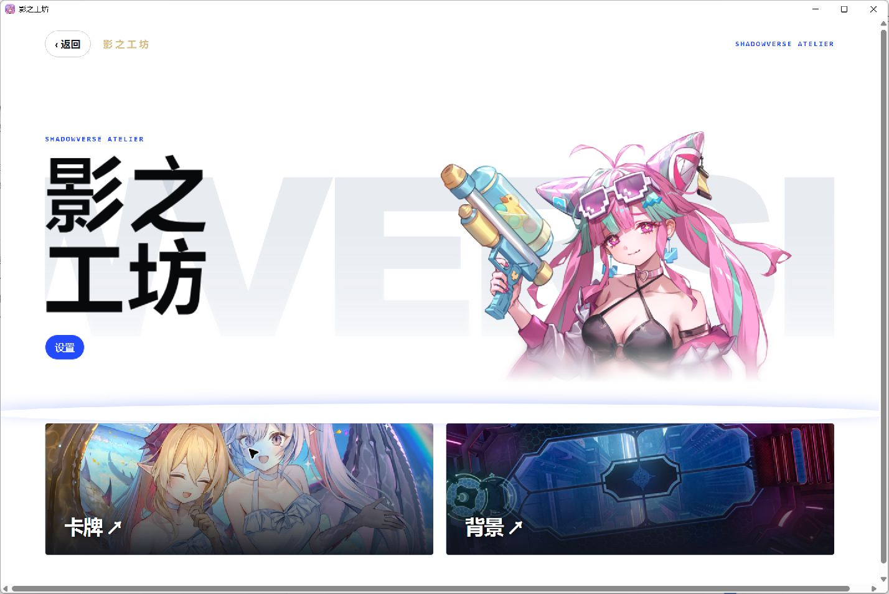
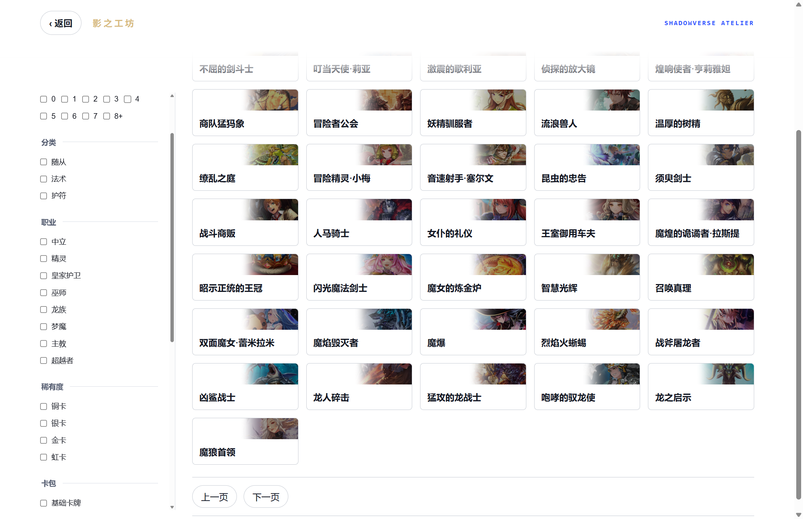
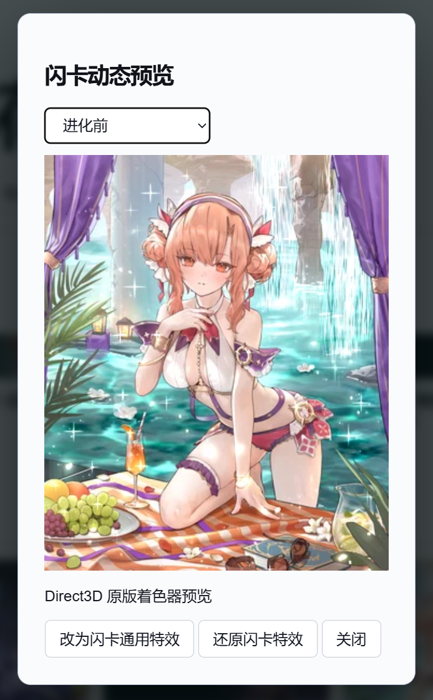
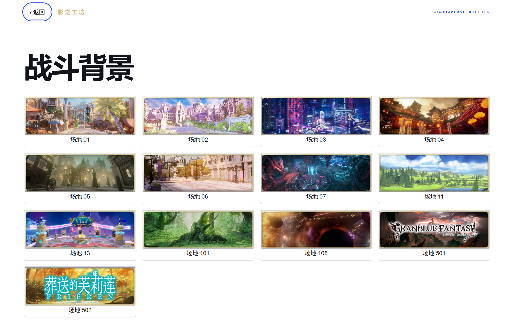

# 影之工坊 · Shadowverse Atelier

影之工坊是《影之诗：超凡世界》国服 Windows PC 高清版的非官方本地 MOD 工具。你可以给一张卡换上自己的插画，单独调整对局中的取景和语音，再把整套修改导出为 ZIP 分享给其他玩家。场地背景也可以独立替换和还原。

[下载 Windows 版](https://github.com/shenbanshenban9-cmyk/Shadowverse-Atelier/releases) · [反馈问题](https://github.com/shenbanshenban9-cmyk/Shadowverse-Atelier/issues)

## 第一次使用

1. 从 **Releases** 下载 Windows 分发包。如果下载的是 ZIP，先解压到自己的文件夹，再运行 **影之工坊.exe**。
2. 在首页打开 **设置 → 游戏路径 → 选择目录**，选中游戏 EXE 所在文件夹，或游戏的 `Persistent` 文件夹。工坊从本机读取资源，首次尚未配置路径时，列表为空。
3. **备份路径** 会自动填写。点击 **保存并读取游戏**，返回首页，从动态立绘下方进入 **卡牌** 或 **背景**。
4. 初次尝试可以只改一张卡。编辑页出现 **待写入** 时，还可以继续调整。点击 **备份并替换** 后，重新启动游戏检查效果。请保留备份目录，后续还原会用到其中的原始资源。

启动时的使用指南可以勾选 **不再显示** 并确认，之后仍可从 **设置 → 使用指南** 打开。当前公开版本面向 Windows，安卓版仍在开发中。

## 找到要编辑的卡

在 **卡牌藏馆** 输入卡名或卡牌编号，也可以组合费用、分类、职业、稀有度和卡包筛选。想找能直接换异画的卡，勾选 **仅显示拥有异画的卡牌**。想继续编辑之前的作品，使用 **修改状态 → 已修改的卡牌**。点 **重置** 可以清空筛选。

游戏更新后，请先在游戏里下载新资源，再重启工坊读取卡牌与卡包。反馈缺卡时附上编号和游戏版本，更容易定位。

## 编辑一张卡牌

### 卡面、横幅与战场取景

| 想调整的画面 | 在哪里操作 |
| --- | --- |
| 卡牌详情里的竖版插画 | 打开对应的进化前、进化后或异画卡面，对照原卡图与当前卡图，点 **新卡图 → ＋** 选图并裁切。 |
| 对局中随从的头像 | 在卡面编辑器的 **战场取景** 中调整位置和范围，检查常态、进化和超进化预览，点 **保存取景**。 |
| 横幅和记牌器小图 | 打开对应卡面旁的 **预览横幅 / 记牌器小图**。点 **使用卡面** 或 **选择图片**，拖动和缩放图像，用固定蒙版检查人物在窄横幅中的位置。 |
| 纹章、信仰图标 | 在拥有对应资源的卡牌中打开图标，选择图片或使用卡面，调整图案在蒙版内的位置。可进化卡牌可选进化前或进化后卡面。 |

完成调整后，回到卡牌页点 **备份并替换**。只想撤销某张卡面时，打开该卡面并点 **恢复原卡图**。确认后会同时重置对应的战场取景，恢复进化后卡面会重置进化与超进化取景。

### 自定义卡名与一键替换异画

- **自定义卡名** 位于卡名大标题下方。输入新名称，点 **备份并写入**，重启游戏查看。需要撤销改名时，在同一窗口点 **恢复默认卡名**。
- **一键替换异画** 会列出该卡可用的异画版本。选定版本后，可以决定是否同步替换异画语音，再写入游戏。某个动作没有单独录音时，工坊会尝试使用该异画同类别的基础语音。
- **一键还原配置** 用于整张卡。先核对确认框列出的恢复内容，再确认还原卡面、横幅、关联图标、取景、语音等已备份资源。

### 闪卡动态预览

在卡名下点 **闪卡动态预览**，选择要查看的卡面。换图后如果仍能看见原角色的发光轮廓，可以点 **改为闪卡通用特效**，从 **花影鎏金**（花瓣与金尘）、**冰晶星河**（星点与光泡）、**紫羽流光**（羽片与花影）中选择。**还原闪卡特效** 可恢复该卡原有的效果。预览便于比较样式，最终光照与混合效果以游戏内为准。

### 动作语音

向下滚动卡牌编辑页，在 **动作语音** 中试听出牌、攻击、被破坏、进化或超进化录音。每张卡显示自身拥有的语音槽。点击要替换的那一条，选择 MP3 或 WAV 文件，工坊会生成试听并自动播放。拖动 **音量** 滑块检查响度，满意后点 **备份并替换**。音频转换由工坊内置工具完成。

## 更换对战场地

1. 从首页进入 **背景**，按缩略图和编号选择场地。
2. 选择新图片，对照 **当前对局资源** 和 **替换预览**，调整缩放与白化程度。工坊按对局相机视角将画面投影到天空盒。
3. 点 **备份并替换**，重启游戏并进入新对局查看。要恢复该场地的原版场景，在同一页点 **还原背景**。

## 导出、导入与批量还原

| 目的 | 操作 |
| --- | --- |
| 分享一张卡 | 先写入想分享的修改，在该卡详情点 **导出单卡配置 → 另存单卡配置**，选择 ZIP 保存位置。 |
| 分享多张卡或场地 | 进入 **设置 → 更改管理**，勾选 **卡牌**、**背景** 或两者，点 **导出所有更改**。导出范围是已写入游戏的更改，包括自定义卡名。 |
| 使用别人分享的配置 | 先设置自己的游戏路径，再点 **设置 → 导入配置文件**，选取收到的 ZIP 并确认。工坊会先备份本机原始资源，再写入更改。 |
| 批量恢复 | 在 **设置 → 更改管理** 选好范围，点 **一键还原所有更改**。确认框会列出所选类别，请核对后继续。 |

导入、导出和批量还原时可以在窗口中查看进度。分享前请确认目标游戏的平台和资源版本，尤其是来自其他版本的 MOD 包。

## 问题反馈

欢迎在 [Issues](https://github.com/shenbanshenban9-cmyk/Shadowverse-Atelier/issues) 提交问题。请写明工坊版本、游戏版本、卡牌编号或场地编号，以及从哪个按钮开始可以复现。如果是预览和游戏效果有差异，附上同一卡面或场地在两个界面里的截图。
